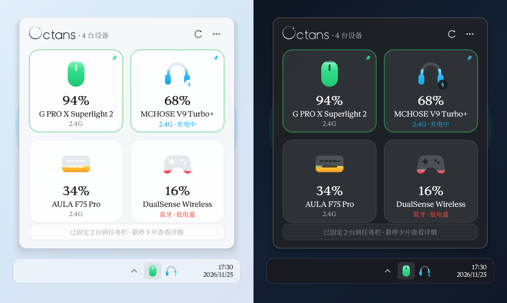

<p align="center">
  <picture>
    <source media="(prefers-color-scheme: dark)" srcset="assets/octans-wordmark-dark@2x.png">
    <source media="(prefers-color-scheme: light)" srcset="assets/octans-wordmark-light@2x.png">
    
  </picture>
</p>

<h3 align="center">轻量原生、极低消耗的 Windows 2.4G 外设托盘电量工具</h3>

<p align="center">
  把 2.4G 无线鼠标、键盘、耳机、手柄的实时电量直接放进 Windows 任务栏右下角——常驻 <b>0% CPU</b>、仅数 MB 内存，告别臃肿官方驱动。
</p>

<p align="center">
  <a href="https://github.com/s0ng1v/Octans/releases/latest"><b>立即下载最新版 (v0.5.0)</b></a>
  ·
  <a href="https://atomgit.com/s0ng1v/Octans/releases"><b>国内高速下载 (AtomGit)</b></a>
  ·
  <a href="#功能亮点">功能亮点</a>
  ·
  <a href="#支持的品牌与外设">支持外设</a>
</p>

<p align="center">
  <a href="https://github.com/s0ng1v/Octans/releases/latest"></a>
  <a href="LICENSE"></a>
  
  
  
</p>

<p align="center">
  
</p>

---

## 功能亮点

- **任务栏右下角一眼看电量**：点击面板中任意设备卡片，即可将其直接固定到 Windows 任务栏托盘，支持同时固定多台外设；取消最后一个固定设备后，托盘自动恢复为极简透明 Octans 图标。
- **常驻性能消耗极低**：静默驻留托盘时 **0% CPU** 占用，不加载任何显卡 3D 驱动或臃肿浏览器内核，闲置自动释放面板内存，全程零后台联网、零遥测，打游戏与办公完全无感。
- **免开多套官方驱动，即插即用**：自动监听 USB 2.4G 接收器热插拔与电脑休眠唤醒，无需同时常驻罗技 G HUB、雷蛇 Synapse、迈从驱动等动辄数百 MB 的后台全家桶。
- **贴心的桌面交互细节**：
  - 自动跟随 Windows 10/11 深色 / 浅色模式切换毛玻璃质感面板；
  - 统一直观的电量色阶（`>40%` 绿、`21%–40%` 橙、`≤20%` 红、充电态清晰标识）；
  - 支持右键自定义设备名称、屏蔽/移除不需要的设备、开机静默自启动；
  - 菜单内置「关于 Octans」，支持手动检查更新并在软件内完成 SHA-256 校验与一键静默升级（优先国内免登录源）。

---

## 三套托盘与面板显示样式

右键托盘图标或点击面板右上角 `···`，即可在三套宇宙主题样式间一键实时切换，并可通过连续滑块自由微调任务栏图标大小：

<p align="center">
  
</p>

| 样式 | 面板表现 | 任务栏托盘表现 |
|---|---|---|
| **`Octans`（默认）** | 外设本体液态充能，通透三段渐变配合轻柔双层流动水波 | 满幅通透三段渐变液态轮廓，零边框高辨识度 |
| **`Nebula`** | 经典圆环电量进度 + 极简线性外设图标 | 紧凑高对比度外环 + 清晰线性图标 |
| **`Pulsar`** | 12 刻度精密环形仪表盘 | 上方大号外设轮廓 + 下方醒目彩色电量数字 |

---

## 下载与安装

推荐直接下载安装程序 **`Octans-Setup-v0.5.0.exe`**，双击一键完成安装（自动配置开机静默启动并支持 Windows 系统标准卸载）：

| 下载通道 | 说明 | 地址 |
|---|---|---|
| **国内镜像（推荐）** | AtomGit 免登录高速直连，国内网络流畅 | [前往 AtomGit Releases 下载](https://atomgit.com/s0ng1v/Octans/releases) |
| **GitHub 官方发布** | 全球主发布页与完整版本归档 | [前往 GitHub Releases 下载](https://github.com/s0ng1v/Octans/releases/latest) |

> **使用提示**：
> 1. 首次安装运行后，若任务栏图标被系统折叠进右下角 `^` 箭头内，直接将其拖出到任务栏即可永久常驻显示。
> 2. 后续升级无需重新找网页，直接在右键菜单点击「关于 Octans → 检查更新」即可自动下载并完成升级。

---

## 支持的品牌与外设

内置 13+ 主流外设厂商私有 2.4G 无线协议、Windows 原生蓝牙电量（`DEVPKEY_Bluetooth_Battery`）、XInput 手柄电量以及标准 HID 电池协议：

| 品牌 / 生态 | 覆盖范围 |
|---|---|
| **罗技 Logitech** | HID++ 2.0（`0x1004` / `0x1000` / `0x1001` / `0x1F20` / `0x0104`）、HID++ 1.0 与蓝牙直连，覆盖 G PRO / GPW / G502 / G903 / G304 / MX 全系鼠键与 G435 / G533 / G535 / G733 / G935 / PRO X 等无线耳机、Astro A50 |
| **迈从 MCHOSE** | 完整 9 通道无线协议，覆盖 A7 / M7 / L7 / G3 / G7 / G7 MAX 等鼠标、BY / CZ 磁轴与机械键盘、V9 / V9 Turbo / V9 Pro 2 / S9 / R9 等无线耳机 |
| **雷蛇 Razer** | 90 字节通用无线鼠键协议及 BlackShark V2 Pro / V3、Barracuda 系列无线耳机 |
| **狼蛛 AULA** | 2.4G 接收器鼠标、0xAA 主协议三模/磁轴键盘与通用 64B 设备 |
| **ATK / VXE / VGN** | Compx 方案、MouseInfo 平台、Nordic 54L15 / nRF52840 无线鼠标及 HFD 键盘 |
| **雷柏 Rapoo** | Vision AP（Telink3228C）、CH315 主动查询与 VT 鼠键被动上报 |
| **黑爵 AJAZZ / 前行者 EWEADN** | `mkbms`（`55 AA 80`）、`0x10` / `0x05` / `0x30` 鼠标及 AK820 系列无线键盘 |
| **达尔优 Dareu** | JM / Compx 方案及 TG / HS Feature Report 无线外设 |
| **海盗船 Corsair / 赛睿 SteelSeries / HyperX** | Bragi / Legacy NXP / Void Elite、Rival / Aerox / Arctis Nova 系列、Cloud II / III / Alpha 与 Airoha HID 系列 |
| **华硕 ROG / 杜伽 DURGOD / IQUNIX / Keychron** | ROG OMNI / Harpe II / Direct、杜伽 FEA-3123、IQUNIX 无线设备、Keychron / Lofree / VIA 键盘 |
| **手柄与通用外设** | Xbox（XInput）、索尼 DualSense / DualShock 4、任天堂 Switch Pro / Joy-Con、八位堂 8BitDo、Steam Controller 及标准 HID / 蓝牙电池设备 |

详细型号清单与实机验证记录见 [docs/06-当前已支持外设清单.md](docs/06-当前已支持外设清单.md)。

---

## 开发者指南与技术架构

> 以下内容面向开发者或希望自行从源码编译的用户。

### 技术实现与极致轻量设计

- **纯原生零依赖**：后端协议引擎采用纯 C11，界面采用 Win32 + Direct2D / DirectWrite 轻量软件渲染（彻底避免常驻加载 D3D11 / GPU 驱动模块，同时对非输入窗口解绑 IME 防止输入法 DLL 注入）；无 Electron / Chromium / WebView2 / .NET / `libstdc++` 运行时依赖。
- **超小体积**：桌面主程序 `Octans.exe` 仅约 **325 KB**，独立命令行工具 `octans-cli.exe` 约 **120 KB**。
- **按需释放与零静态网络导入**：面板关闭后自动释放离屏缓冲并触发工作集回收；PE 导入表零网络 DLL 静态依赖，仅在用户手动点击检查更新时按需动态加载 `winhttp.dll` 与 `bcrypt.dll`。

### 目录结构

```text
core/       底层 HID / SetupDi 蓝牙 / XInput / cfgmgr32 热插拔（纯 C11）
engine/     多厂商无线协议引擎、编译期轻量表混淆、外部规则引擎与配置持久化（纯 C11）
ui/         原生 Win32 / Direct2D / DirectWrite 界面、液态渲染与托盘组件
app/        桌面主程序入口（单实例互斥、热插拔/休眠唤醒监听、后台工作线程）
cli/        独立无头命令行工具（支持 list --json、test-rule、probe --dump）
include/    后端与 UI 稳定 C ABI 头文件与版本定义
assets/     Octans 品牌视觉资产与多分辨率图标
installer/  Inno Setup 安装脚本与一键打包脚本
tests/      协议解析、混淆表匹配与 ABI 单元测试（356 项断言）
```

### 从源码构建

需要 Windows 10/11 与 LLVM-MinGW (UCRT) 工具链（打包安装程序需 Inno Setup 6）：

```powershell
# 一键编译命令行工具、运行 356 项单元测试并构建 build\Octans.exe
powershell -ExecutionPolicy Bypass -File .\build.ps1

# 一键构建并打包为 Windows 安装程序（输出 dist\Octans-Setup-v0.5.0.exe）
powershell -ExecutionPolicy Bypass -File .\installer\package.ps1

# 单独编译并预览无硬件 UI Demo
powershell -ExecutionPolicy Bypass -File .\ui\build_ui.ps1
.\build\octans_ui_demo.exe
```

---

## 开源协议与品牌声明

- **源代码许可**：本项目源代码遵循 [GNU General Public License v3.0 (GPL-3.0-only)](LICENSE) 协议开源。任何基于本项目的修改或再分发均须以同等 GPL-3.0 协议公开全部源代码。
- **品牌与美术资产保留**：`Octans` 名称、Logo、Wordmark、应用图标及截图资产（`assets/` 目录下的全部品牌视觉资产）**不适用 GPL-3.0 协议，保留所有权利**，详见 [TRADEMARK.md](TRADEMARK.md)。任何二次分发或衍生作品须移除并替换为独立名称与图标。
- **版权与商业授权**：版权归原作者 `s0ng1v` 所有，如需非 GPL 商业授权请联系作者。
