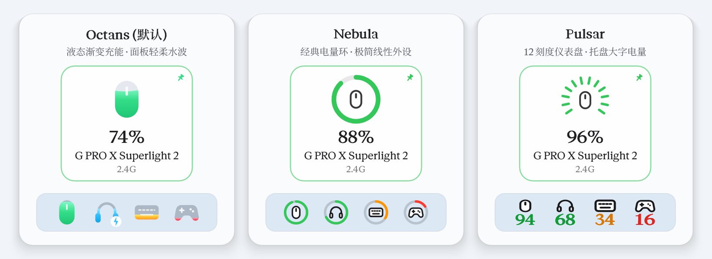

<p align="center">
  <picture>
    <source media="(prefers-color-scheme: dark)" srcset="assets/octans-wordmark-dark@2x.png">
    <source media="(prefers-color-scheme: light)" srcset="assets/octans-wordmark-light@2x.png">
    
  </picture>
</p>

<h3 align="center">在任务栏实时显示你的无线外设电量</h3>

<p align="center">
  轻量原生 · 支持 2.4G 与蓝牙鼠键、耳机和手柄 · 常驻 <b>0% CPU</b>、<b>&lt; 5 MB 内存</b>，告别臃肿驱动
</p>

<p align="center">
  <b>简体中文</b>
  ·
  <a href="README_EN.md">English</a>
  ·
  <a href="https://atomgit.com/gcw_dkdsv0bD/Octans/releases/download/v1.2.3/Octans-Setup-v1.2.3.exe"><b>国内高速下载</b></a>
  ·
  <a href="https://github.com/s0ng1v/Octans/releases/latest"><b>GitHub Releases</b></a>
  ·
  <a href="#支持的品牌与外设">支持外设</a>
</p>

<p align="center">
  <a href="https://github.com/s0ng1v/Octans/releases/download/v1.2.3/Octans-Setup-v1.2.3.exe"></a>
  <a href="LICENSE"></a>
  
  
  
</p>

<p align="center">
  
</p>

<p align="center">
  
</p>


## 功能亮点

- **任务栏右下角一眼看电量**：点击面板中任意设备卡片，即可将其直接固定到 Windows 任务栏托盘，支持同时固定多台外设到任务栏。
- **常驻性能消耗极低**：静默驻留托盘时 0% CPU、< 5 MB 内存，不加载任何显卡 3D 驱动或浏览器内核，闲置自动释放面板内存，全程零遥测（默认每日最多仅只读检查一次公开版本号，绝不静默下载且不上传任何信息，可在右键菜单一键关闭）。
- **即装即用**：支持 30+ 主流品牌的 2.4G 无线鼠标、键盘、耳机与手柄，自动监听 USB 2.4G 接收器热插拔与电脑休眠唤醒，无需运行驱动程序。


## 下载与安装

推荐直接下载安装程序 **`Octans-Setup-v1.2.3.exe`**，双击一键完成安装（自动配置开机静默启动并支持 Windows 系统标准卸载）：

| 下载通道 | 说明 | 地址 |
|---|---|---|
| **国内高速下载（推荐）** | AtomGit 官方 CDN 免登录直下，国内网络流畅 | [直接下载 Octans-Setup-v1.2.3.exe](https://atomgit.com/gcw_dkdsv0bD/Octans/releases/download/v1.2.3/Octans-Setup-v1.2.3.exe) · [全部版本](https://atomgit.com/gcw_dkdsv0bD/Octans/releases) |
| **GitHub 官方发布** | 全球主发布页与完整版本归档 | [直接下载 Octans-Setup-v1.2.3.exe](https://github.com/s0ng1v/Octans/releases/download/v1.2.3/Octans-Setup-v1.2.3.exe) · [Releases 页面](https://github.com/s0ng1v/Octans/releases/latest) |

> **使用提示**：
> 1. 首次安装运行后，若任务栏图标被系统折叠进右下角 `^` 箭头内，直接将其拖出到任务栏即可永久常驻显示。
> 2. 当有新版本发布时，主面板右上角会出现「↑ 新版」提示，也可随时在右键菜单点击「关于 Octans → 检查更新」自动下载、校验 SHA256 并静默升级（可在右键菜单关闭「自动检查更新」）。


## 支持的品牌与外设

支持 30+ 主流品牌的 2.4G 无线外设、蓝牙设备与无线手柄，涵盖鼠标、键盘、耳机与手柄，即插即用（部分型号未经真机测试，可能会有检测不到的情况，欢迎提 Issues）：

| 品牌 | 支持设备与常见型号 |
|---|---|
| **罗技 Logitech** | G PRO / GPW 全系、G502 / G903 / G304、MX 办公鼠键；G915 / MX Keys 等键盘；G435 / G533 / G535 / G733 / G935 / PRO X、Astro A50 等无线耳机 |
| **雷蛇 Razer** | 炼狱蝰蛇 V3/V4 Pro、毒蝰 V2/V3/V4 Pro、巴塞利斯蛇等鼠标；黑寡妇 / 噬魂金蝎无线键盘；旋风黑鲨 V2 Pro / V3、梭鱼系列无线耳机 |
| **海盗船 / 赛睿 / HyperX / 索尼 / 联想 / 音珀 EPOS / 斐风 FIFINE** | 海盗船无线鼠键耳机；赛睿 Aerox 鼠标、Arctis 1 / Nova / GameBuds 耳机；HyperX 飓风 Cloud II / III / Alpha / Flight 耳机与脉冲星鼠标；索尼 INZONE Buds / PULSE 3D；联想无线耳机；音珀 H3PRO；斐风 HT6 |
| **华硕 ROG / 杜伽 DURGOD / 铝厂 IQUNIX / Keychron / 洛斐** | 华硕 ROG 龙鳞 / 月刃 / 战刃等无线鼠键；杜伽无线键盘；IQUNIX 无线键鼠；Keychron、洛斐等主流三模机械键盘 |
| **雷柏 Rapoo** | VT0 / VT0 MAX / VT0 Air MAX、VT1 / VT3 / VT7 / VT9 二代及全系 VT 无线鼠标、V700DIY 无线键盘与无线接收器外设 |
| **漫步者 EDIFIER / 漫步者电竞 HECATE** | HECATE G5 MAX / G5 MAX V2 / G5 MAX 底座版 / G4 MAX / G3 MAX / G3 / G2 MAX / V5 MAX / V3 MAX 无线耳机、GX03 ULTRA / GX05 大师版无线 TWS、G5M PRO / G5M ULTRA / G3M PRO 升级版 / G3M ULTRA / G2M PRO 无线鼠标；花再 Halo Space / Evo Space 无线耳机与 TempoHub 键鼠（蓝牙耳机同步直读） |
| **ATK / VXE / VGN / 兰族 LAMZU / 忍者 Ninjutso / Pulsar / 影魔 WLmouse** | ATK / VXE 蜻蜓 R1、F1、A9 / A9 Pro Max、X1 / X1 Ultimate、V3 星闪鼠标及 A87 / A98 键盘；兰族 Maya X / Inca / Atlantis；忍者 Sora V2；Pulsar X2 / Xlite；影魔 Beast X；扎品 Z1 Pro / Z2 等主流轻量化鼠标 |
| **迈从 MCHOSE** | A7 / M7 / L7 / G3 / G7 / G7 MAX / A5 / K5 / R7 等无线鼠标；G87 V3 / K87 V3 / G98 V3 / K99 V3 / G87 V2 / G75 V2 / K87S / X75 / Z75 及磁轴机械键盘；V9 / V9 Turbo / V9 Pro 2 / S9 / R9 等无线耳机 |
| **凌豹 LEOBOG / 狼蛛 AULA** | 凌豹 Hi75C Pro / Hi98 Pro / Hi87 Pro / Hi8 / AMG65 等三模键盘与 GM2 系列无线鼠标；狼蛛 F75 / F87 / F87 Pro V2C / F99 等全系无线鼠键 |
| **黑爵 AJAZZ / 前行者 EWEADN / 达尔优 Dareu** | 黑爵 AJ179、AK820 等无线鼠键；前行者 S9 / H2；达尔优 A950 / A900 等 |
| **机械师 Machenike / 雷神 ThundeRobot** | 机械师 L8 MAX、雷神 ML9 mini、X7s Pro / Pro Max / Ultra 等无线鼠标与无线手柄 |
| **WOB / 艾酷 Akko / 魔极客 MonsGeek** | WOB Rainy75 V2、Zen65 键盘与 Rainy S1 鼠标；艾酷 Akko / 魔极客 MonsGeek 三模键盘（含 FUN60 Pro 等系列） |
| **达摩鲨 Darmoshark** | M3 / M3S / M3 Pro / M3S Pro / M2 / M5 / N3 / N5 等 2.4G 与 4K/8K 无线鼠标及三模键盘 |
| **因科特 INCOTT / 攻击鲨 Attack Shark / 血手幽灵 Bloody / Bytech 916** | 因科特 G23 / G24 / Ghero / Zero 系列；攻击鲨 X11 / X3 / X6 / R1 系列；双飞燕血手幽灵 SG5 Pro 等 8K 无线鼠标；Bytech 916 平台三模键盘（含 RK R98Pro V2、VGN V98Pro V3 / V87 V2 / V108、GravaStar 等） |
| **无线手柄与通用蓝牙外设** | 飞智八爪鱼 5 / 黑武士 5 Pro / 八爪鱼 6（2.4G / 有线私有协议直读）、Xbox 无线手柄、盖世小鸡 / 北通 / 八位堂等主流无线手柄；索尼 DualSense / DualShock 4；任天堂 Switch Pro / Joy-Con；以及绝大多数蓝牙鼠标、蓝牙键盘与蓝牙耳机 |

详细型号清单与实机验证记录见 [docs/当前已支持外设清单.md](docs/当前已支持外设清单.md)。


## 开发者指南与技术架构

> 以下内容面向开发者或希望自行从源码编译的用户。

### 技术实现与极致轻量设计

- **纯原生零依赖**：后端协议引擎采用纯 C11，界面采用 Win32 + Direct2D / DirectWrite 轻量软件渲染（彻底避免常驻加载 D3D11 / GPU 驱动模块，同时对非输入窗口解绑 IME 防止输入法 DLL 注入）；无 Electron / Chromium / WebView2 / .NET / `libstdc++` 运行时依赖。
- **超小体积**：桌面主程序 `Octans.exe` 仅约 **389 KB**，独立命令行工具 `octans-cli.exe` 约 **187 KB**。
- **按需释放与零静态网络导入**：面板关闭后自动释放离屏缓冲并触发工作集回收；PE 导入表零网络 DLL 静态依赖，仅在检查或下载更新时按需动态加载 `winhttp.dll` 与 `bcrypt.dll` 并在完成后立即卸载。

### 目录结构

```text
core/       底层 HID / SetupDi 蓝牙 / XInput / cfgmgr32 热插拔（纯 C11）
engine/     多厂商无线协议引擎、编译期轻量表混淆、外部规则引擎与配置持久化（纯 C11）
ui/         原生 Win32 / Direct2D / DirectWrite 界面、液态渲染与托盘组件
app/        桌面主程序入口（单实例互斥、热插拔/休眠唤醒监听、后台工作线程）
cli/        独立无头命令行工具（支持 list --json、test-rule、probe --dump）
include/    后端与 UI 稳定 C ABI 头文件与版本定义
assets/     Octans 品牌视觉资产与多分辨率图标
installer/  Inno Setup 安装脚本与一键打包脚本
tests/      协议解析、混淆表匹配、多端去重与 ABI 单元测试（770 项断言）
```

### 从源码构建

需要 Windows 10/11 与 LLVM-MinGW (UCRT) 工具链（打包安装程序需 Inno Setup 6）：

```powershell
# 一键编译命令行工具、运行 770 项单元测试并构建 build\Octans.exe
powershell -ExecutionPolicy Bypass -File .\build.ps1

# 一键构建并打包为 Windows 安装程序（输出 dist\Octans-Setup-v1.2.3.exe）
powershell -ExecutionPolicy Bypass -File .\installer\package.ps1

# 单独编译并预览无硬件 UI Demo
powershell -ExecutionPolicy Bypass -File .\ui\build_ui.ps1
.\build\octans_ui_demo.exe
```


## 开源协议与品牌声明

- **源代码许可**：本项目源代码遵循 [GNU General Public License v3.0 (GPL-3.0-only)](LICENSE) 协议开源。任何基于本项目的修改或再分发均须以同等 GPL-3.0 协议公开全部源代码。
- **品牌与美术资产保留**：`Octans` 名称、Logo、Wordmark、应用图标及截图资产（`assets/` 目录下的全部品牌视觉资产）**不适用 GPL-3.0 协议，保留所有权利**，详见 [TRADEMARK.md](TRADEMARK.md)。任何二次分发或衍生作品须移除并替换为独立名称与图标。
- **版权与商业授权**：版权归原作者 `s0ng1v` 所有，如需非 GPL 商业授权请联系作者。


## 社区交流

本项目首发并推荐于 **[LINUX DO](https://linux.do)** 社区，认可并感谢 LINUX DO 社区真诚、友善、专业的开源交流氛围。欢迎前往社区讨论交流，或在 GitHub Issues 反馈新设备适配需求。
