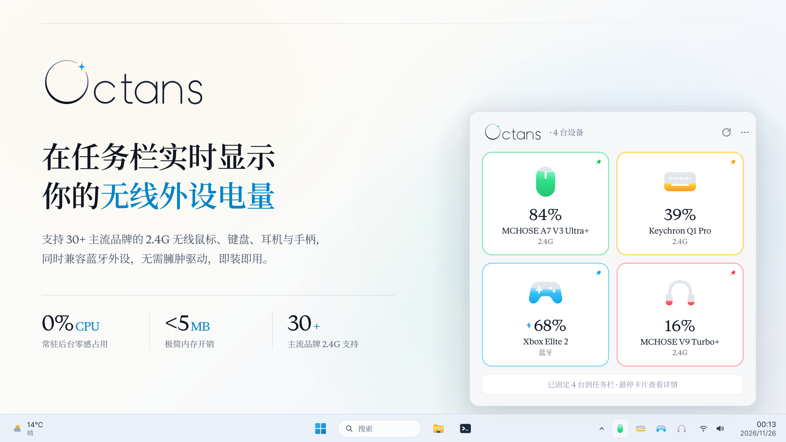
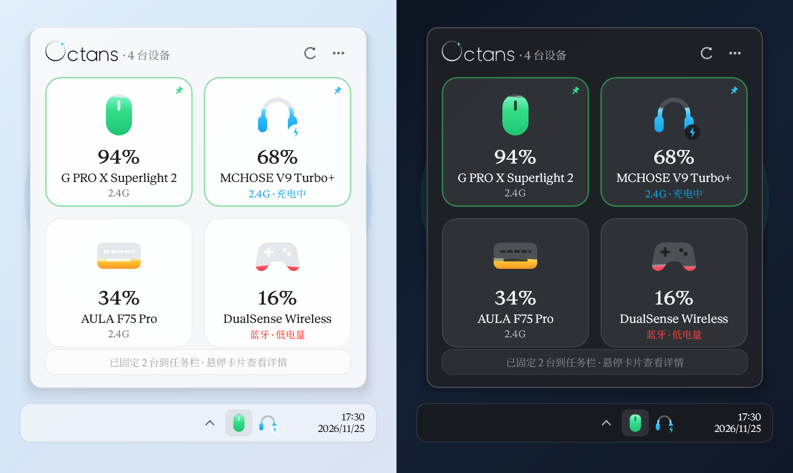
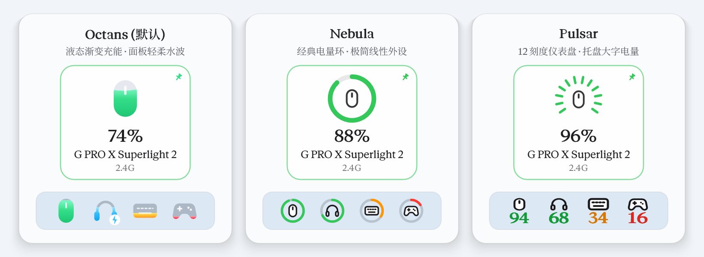

<p align="center">
  <picture>
    <source media="(prefers-color-scheme: dark)" srcset="assets/octans-wordmark-dark@2x.png">
    <source media="(prefers-color-scheme: light)" srcset="assets/octans-wordmark-light@2x.png">
    
  </picture>
</p>

<h3 align="center">Real-time wireless peripheral battery in your Windows taskbar</h3>

<p align="center">
  Lightweight &amp; native · 2.4G &amp; Bluetooth mice, keyboards, headsets, controllers · <b>0% CPU</b>, <b>&lt; 5 MB RAM</b>, no vendor bloat
</p>

<p align="center">
  <a href="README.md">简体中文</a>
  ·
  <b>English</b>
  ·
  <a href="https://github.com/s0ng1v/Octans/releases/download/v1.2.0/Octans-Setup-v1.2.0.exe"><b>Download (v1.2.0)</b></a>
  ·
  <a href="https://atomgit.com/gcw_dkdsv0bD/Octans/releases/download/v1.2.0/Octans-Setup-v1.2.0.exe">CN Mirror</a>
  ·
  <a href="#supported-brands--devices">Supported Devices</a>
</p>

<p align="center">
  <a href="https://github.com/s0ng1v/Octans/releases/download/v1.2.0/Octans-Setup-v1.2.0.exe"></a>
  <a href="LICENSE"></a>
  
  
  
</p>

<p align="center">
  
</p>

<p align="center">
  
</p>

<p align="center">
  
</p>

---

## Highlights

- **At-a-Glance Taskbar Battery**: Click any device card in the panel to pin it directly to the Windows system tray, supporting multiple pinned peripherals simultaneously. Unpinning the last device automatically restores the minimal transparent Octans tray icon.
- **Three Switchable Styles**: Built-in **`Octans`** (liquid gradient wave, default), **`Nebula`** (classic battery ring), and **`Pulsar`** (large numeric battery readout), plus a smooth slider to fine-tune tray icon size.
- **Ultra-Low Resource Footprint**: Uses **0% CPU** and **< 5 MB RAM** while sitting quietly in the tray, without loading GPU 3D drivers or heavy browser runtimes. Panel buffers are released when hidden, with zero background telemetry or unrequested network traffic.
- **Plug-and-Play Without Vendor Bloat**: Automatically tracks USB 2.4G receiver hot-plug events and Windows sleep/wake cycles so you no longer need to keep Logitech G HUB, Razer Synapse, or multiple heavy driver suites running in the background.

---

## Download & Install

Download the installer **`Octans-Setup-v1.2.0.exe`** and double-click to install (supports silent startup at login and standard Windows uninstallation):

| Channel | Description | Link |
|---|---|---|
| **GitHub Releases (Recommended)** | Official global releases & version archive | [Download Octans-Setup-v1.2.0.exe](https://github.com/s0ng1v/Octans/releases/download/v1.2.0/Octans-Setup-v1.2.0.exe) · [Releases Page](https://github.com/s0ng1v/Octans/releases/latest) |
| **CN Mirror (AtomGit)** | High-speed direct download in Mainland China without login | [Download Octans-Setup-v1.2.0.exe](https://atomgit.com/gcw_dkdsv0bD/Octans/releases/download/v1.2.0/Octans-Setup-v1.2.0.exe) · [All Releases](https://atomgit.com/gcw_dkdsv0bD/Octans/releases) |

> **Tips**:
> 1. If Windows hides the newly installed tray icon inside the `^` overflow menu, drag it out to the taskbar once to keep it permanently visible.
> 2. Future updates can be installed directly inside the app via right-click menu **"About Octans → Check for Updates"**.

---

## Supported Brands & Devices

Supports wireless mice, keyboards, headsets, and gamepads from 20+ mainstream brands out of the box across 2.4G wireless and Bluetooth (some models have not been hardware-tested yet and may not be detected — feel free to open an Issue):

| Brand | Supported Devices & Popular Models |
|---|---|
| **Logitech** | G PRO / GPW series, G502 / G903 / G304, MX series mice; G915 / MX Keys keyboards; G435 / G533 / G535 / G733 / G935 / PRO X, Astro A50 wireless headsets |
| **Razer** | DeathAdder V3/V4 Pro, Viper V2/V3/V4 Pro, Basilisk wireless mice; BlackWidow / DeathStalker wireless keyboards; BlackShark V2 Pro / V3 and Barracuda headsets |
| **Corsair / SteelSeries / HyperX / Sony / Lenovo / EPOS / FIFINE** | Corsair wireless mice, keyboards & headsets; SteelSeries Aerox mice and Arctis 1 / Nova / GameBuds headsets; HyperX Cloud II / III / Alpha / Flight & Pulsefire mice; Sony INZONE Buds / PULSE 3D; Lenovo wireless headsets; EPOS H3PRO; FIFINE HT6 |
| **ASUS ROG / DURGOD / IQUNIX / Keychron / Lofree** | ASUS ROG Harpe / Keris / Gladius wireless peripherals; DURGOD wireless keyboards; IQUNIX keyboards & mice; Keychron & Lofree tri-mode mechanical keyboards |
| **Rapoo** | VT0 / VT0 MAX / VT0 Air MAX, VT1 / VT3 / VT7 / VT9 Gen-2 & VT-series wireless mice, V700DIY keyboards, and wireless receivers |
| **EDIFIER / HECATE** | HECATE G5 MAX / G5 MAX V2 / G5 MAX Dock / G4 MAX / G3 MAX / G3 / G2 MAX / V5 MAX / V3 MAX wireless headsets, GX03 ULTRA / GX05 Master TWS earbuds, G5M PRO / G5M ULTRA / G3M PRO / G3M ULTRA / G2M PRO mice; EDIFIER Halo Space / Evo Space headphones & TempoHub peripherals |
| **ATK / VXE / VGN / LAMZU / Ninjutso / Pulsar / WLmouse** | ATK / VXE Dragonfly R1, F1, A9 / A9 Pro Max, X1 / X1 Ultimate, V3 Nearlink mice & A87 / A98 keyboards; LAMZU Maya X / Inca / Atlantis; Ninjutso Sora V2; Pulsar X2 / Xlite; WLmouse Beast X; Zaopin Z1 Pro / Z2 |
| **MCHOSE** | A7 / M7 / L7 / G3 / G7 / G7 MAX / A5 / K5 / R7 mice; G87 / G87 V2 / G98 / K99 / X75 / Z75 & magnetic/mechanical keyboards; V9 / V9 Turbo / V9 Pro 2 / S9 / R9 headsets |
| **LEOBOG / AULA** | LEOBOG Hi75C Pro / Hi98 Pro / Hi87 Pro / Hi8 / AMG65 tri-mode keyboards and GM2 series wireless mice; AULA F75 / F87 / F87 Pro V2C / F99 wireless keyboards & mice |
| **AJAZZ / EWEADN / Dareu** | AJAZZ AJ179, AK820; EWEADN S9 / H2; Dareu A950 / A900 |
| **Machenike / ThundeRobot** | Machenike L8 MAX, ThundeRobot ML9 mini, X7s Pro / Pro Max / Ultra wireless mice and wireless controllers |
| **WOB / Akko / MonsGeek** | WOB Rainy75 V2, Zen65 keyboards and Rainy S1 mouse; Akko / MonsGeek tri-mode keyboards (including FUN60 Pro series) |
| **Darmoshark** | M3 / M3S / M3 Pro / M3S Pro / M2 / M5 / N3 / N5 2.4G & 4K/8K wireless mice and tri-mode keyboards |
| **INCOTT / Attack Shark / Bloody** | INCOTT G23 / G24 / Ghero / Zero series; Attack Shark X11 / X3 / X6 / R1 series; A4Tech Bloody SG5 Pro 8K wireless mice |
| **Controllers & Bluetooth Peripherals** | Xbox wireless controllers, Flydigi / GameSir / Beitong / 8BitDo controllers; Sony DualSense / DualShock 4; Nintendo Switch Pro / Joy-Con; plus most standard Bluetooth mice, keyboards, and headsets |

See [docs/当前已支持外设清单.md](docs/当前已支持外设清单.md) for the detailed device list and hardware verification notes (in Chinese).

---

## Developer Guide & Build from Source

> The section below is intended for developers or users building from source.

### Architecture & Lightweight Design

- **Pure Native Zero-Dependency Stack**: C11 backend protocol engine with Win32 + Direct2D / DirectWrite lightweight software rendering (avoiding persistent D3D11/GPU module loading and unbinding IME from non-input windows); zero Electron / Chromium / WebView2 / .NET / `libstdc++` runtime dependencies.
- **Tiny Footprint**: `Octans.exe` is only ~**373 KB**, and the standalone CLI `octans-cli.exe` is ~**175 KB**.
- **On-Demand Cleanup & Zero Static Network Imports**: Releases off-screen panel surfaces and trims working set when collapsed; zero static network DLL imports in PE tables (`winhttp.dll` and `bcrypt.dll` are dynamically loaded only when the user checks for updates).

### Repository Layout

```text
core/       Low-level HID, SetupDi Bluetooth, XInput & cfgmgr32 hot-plug (C11)
engine/     Multi-vendor wireless protocol engine, compile-time obfuscated tables, external rules & config (C11)
ui/         Native Win32 / Direct2D / DirectWrite UI, liquid wave renderer & tray integration
app/        Desktop application entrypoint (single-instance mutex, hot-plug/power events, worker loop)
cli/        Standalone headless CLI tool (list --json, test-rule, probe --dump)
include/    Stable C ABI headers and version definitions
assets/     Octans brand visual assets and multi-DPI icons
installer/  Inno Setup script and one-click packaging script
tests/      Unit tests covering protocol parsing, table lookup, deduplication & ABI (648 assertions)
```

### Build from Source

Requires Windows 10/11 and the LLVM-MinGW (UCRT) toolchain (plus Inno Setup 6 for packaging):

```powershell
# Build CLI, run all 648 unit tests, and build build\Octans.exe
powershell -ExecutionPolicy Bypass -File .\build.ps1

# Build and package the Windows installer (outputs dist\Octans-Setup-v1.2.0.exe)
powershell -ExecutionPolicy Bypass -File .\installer\package.ps1

# Build and launch the hardware-free UI preview demo
powershell -ExecutionPolicy Bypass -File .\ui\build_ui.ps1
.\build\octans_ui_demo.exe
```

---

## License & Trademark

- **Source Code License**: Source code is licensed under [GNU General Public License v3.0 (GPL-3.0-only)](LICENSE). Any modified or redistributed versions must disclose full source code under the same GPL-3.0 terms.
- **Brand & Visual Assets Reserved**: The `Octans` name, logo, wordmark, app icons, and screenshot assets (all brand visual files under `assets/`) are **excluded from GPL-3.0 with all rights reserved** — see [TRADEMARK.md](TRADEMARK.md). Derivatives must remove and replace them with independent branding.
- **Copyright & Commercial Licensing**: Copyright `s0ng1v`. Contact the author for non-GPL commercial licensing.
